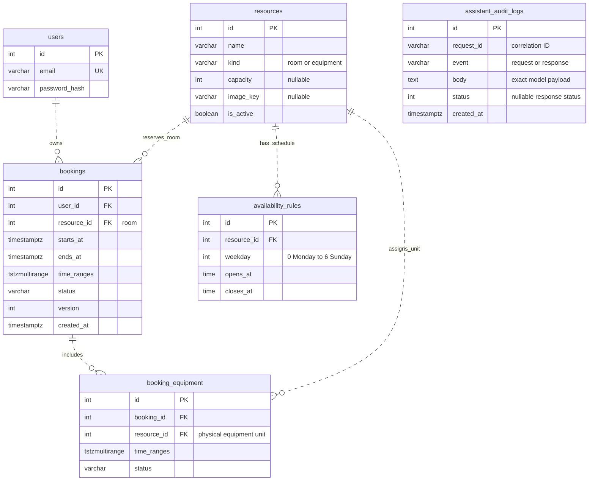
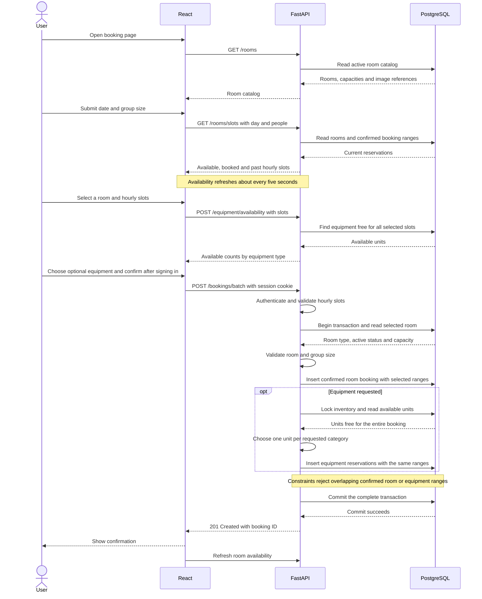
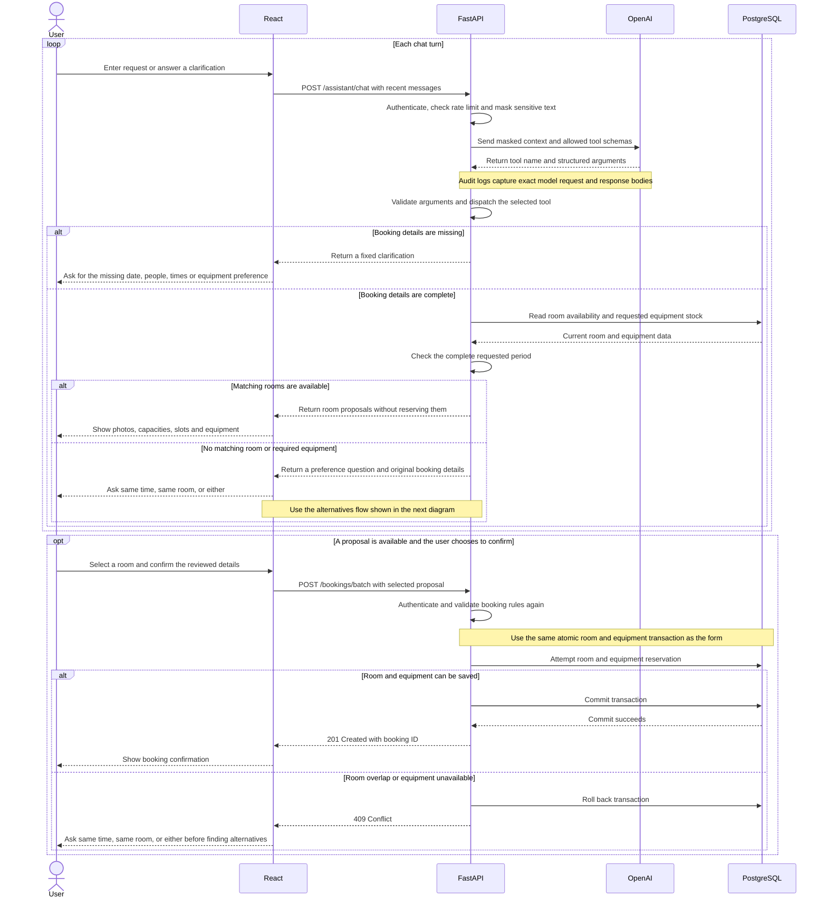
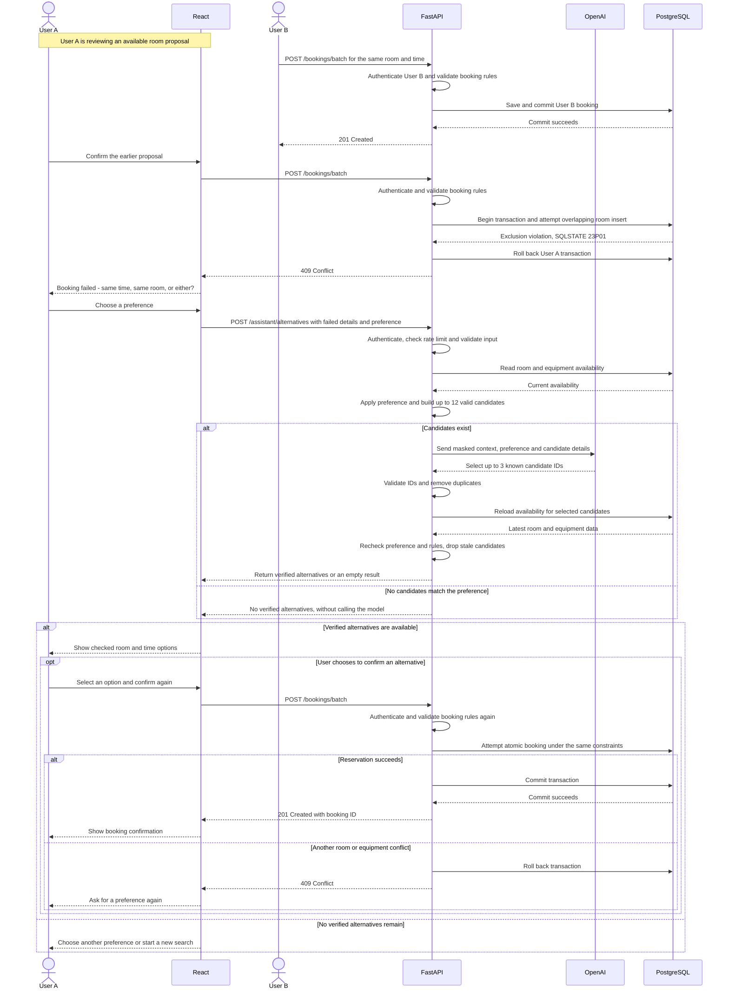

# Data model and booking flows

[Back to README](../README.md)

These Mermaid diagrams render directly on GitHub. API paths below are FastAPI routes; the React app calls them through Vite's `/api` proxy. Protected requests use the signed session cookie. Database reads and writes are grouped for readability.

## ER diagram

`assistant_audit_logs` is an independent private log table, correlated by `request_id` rather than a booking foreign key. It is used on Vercel; local development defaults to the JSONL file.

A user can own many bookings. Each booking reserves one room and can include multiple equipment units through `booking_equipment`. Both rooms and individual equipment units live in `resources`; the backend enforces their roles. Each child row belongs to exactly one referenced parent. The dotted relationships are non-identifying: child tables have their own primary keys.

`time_ranges` stores the actual occupied periods, including gaps. `starts_at` and `ends_at` store the outer boundaries. Group size is validated against capacity when creating a booking but is not stored as a booking column. The schema supports `confirmed`, `cancelled`, and `completed`; automatic completion is not implemented. `availability_rules` is reserved for future schedules; current opening hours come from `backend/availability.py`.

The unique pair `(booking_id, resource_id)` prevents duplicate equipment links. PostgreSQL exclusion constraints prevent overlapping confirmed reservations for the same room or equipment unit. These constraints are explained in [How bookings stay consistent](design.md#how-bookings-stay-consistent).

## Normal booking through the form

This diagram shows a successful booking. Browsing rooms does not require sign-in, but confirmation does. Equipment is optional, and no model call is needed. If a room or equipment conflict occurs during the transaction, the backend rolls back all changes and returns 409. The normal form shows the error and refreshes availability so the user can change the selection.

## Booking through the AI assistant

Chat requires sign-in. The model returns a tool call, and FastAPI validates its arguments before running the corresponding Python function. A clarification waits for another user message. A complete request either produces room proposals or asks about alternative preferences. Only a selected proposal with explicit confirmation reaches the booking API.

The booking transaction is expanded in the normal-form diagram. Room overlaps are rejected by PostgreSQL. Equipment shortages can also be detected by the backend after reading available units. Both produce a rollback and 409, rather than leaving a partial booking. Model failures or invalid model arguments stop the proposal flow with an error. They do not create a reservation, and the normal form remains available.

## Someone else books before confirmation

This example starts with User A reviewing a proposal. User B confirms an overlapping room booking first. User B's UI is omitted to keep the diagram readable. The database rejects User A's reservation, and React asks for a preference before calling the alternatives endpoint. No model call is needed just to show that question.

Selected alternatives still require a separate user confirmation. The final availability check does not hold a room or equipment unit. If the model call fails or returns invalid IDs, the endpoint returns an error instead of showing unverified options. The UI offers a retry, and the normal booking form remains available. If options are shown but the user does not confirm, no booking is written.
